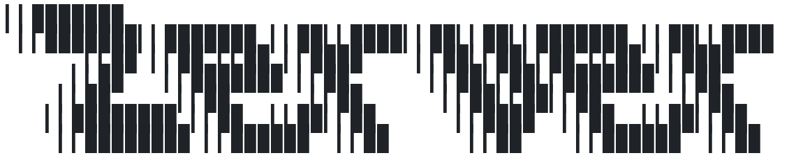
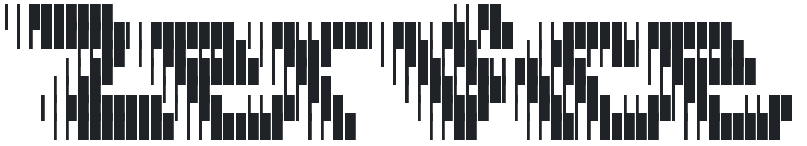

<picture>
  <source media="(prefers-color-scheme: dark)" srcset="../docs/logo/zerver-dark.png">
  
</picture>

# zerver

Axum REST API server for Zwipe. Re-exports domain types from `zwipe-core` and adds server-specific layers.

## Responsibilities

- HTTP handlers: Axum route handlers, middleware, JWT auth extraction (`src/lib/inbound/http/`), covering auth, card, deck, deck_card, user, and metrics endpoints
- Database adapters: SQLx repositories with `Database*` wrapper types for Postgres (`src/lib/outbound/sqlx/`)
- External adapters: Scryfall card ingest (`inbound/external/scryfall`), Archidekt deck-list import (`outbound/archidekt`), Resend transactional email (`outbound/resend`)
- Service layer: business logic orchestration, port trait implementations
- Port traits: repository and service interfaces
- Service-layer errors: error types wrapping `anyhow::Error` (not in core)
- Server-only domains: modules that need server deps but not clients: `health`, `metrics`, `email`
- Binaries: `zerver` (web server) and `zervice` (background sync jobs)

## Key pattern

Domain types live in `zwipe-core`. Zerver re-exports via `pub use zwipe_core::...` and adds only what requires server-only dependencies (sqlx, axum, argon2, jsonwebtoken, tokio).

Database persistence uses `Database*` wrapper structs with primitive fields; domain types never have SQLx derives.

<picture>
  <source media="(prefers-color-scheme: dark)" srcset="../docs/logo/zervice-dark.png">
  
</picture>

## zervice

The second binary in this crate. It runs once and exits, nightly on a systemd timer in production: card sync from Scryfall, oracle tags, derived categories, materialized view refreshes, then upkeep prunes. Each step logs its own result, and a failed step doesn't stop the ones after it.
